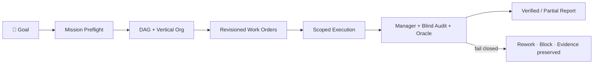
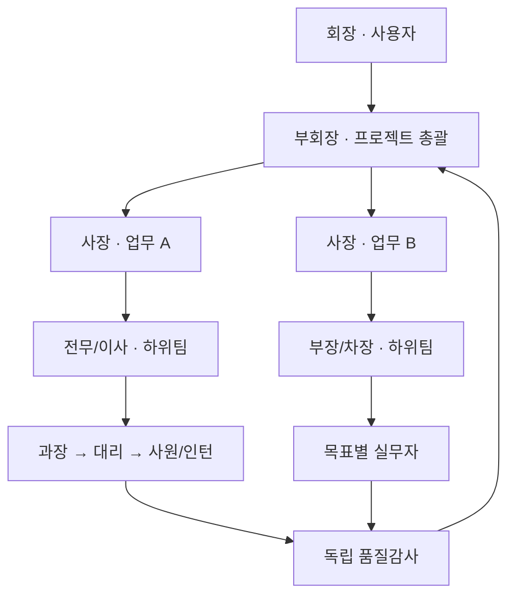
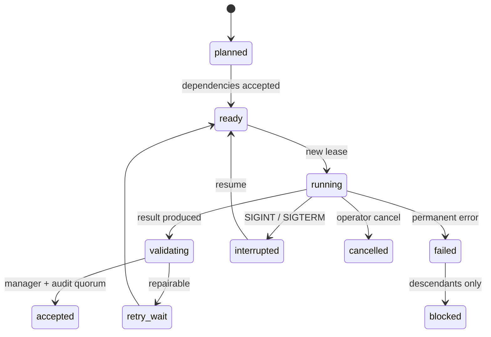

<div align="center">

# 🌙 Luna Swarm

### 목표를 던지면, 검증 가능한 수직 조직이 실행합니다.

ChatGPT 인증 Codex App Server 위에서 움직이는 **적응형 수직 조직형 다중 에이전트 오케스트레이터**

[](https://github.com/jsk1004ha/luna-swarm/actions/workflows/ci.yml?query=branch%3Amain)


[빠른 시작](#quickstart) · [작동 방식](#architecture) · [운영 명령](#commands) · [안전 경계](#safety) · [검증](#verification) · [문서 지도](#documents)

</div>

> [!IMPORTANT]
> Luna Swarm은 “같은 질문을 여러 번 던지는” fan-out 도구가 아닙니다. 목표를 DAG와 revisioned Work Order로 바꾸고, 실행자·관리자·독립 감사자·Oracle·최종 critic을 서로 다른 권위 경계에 배치합니다. 기본 Swarm은 `read`/`search` 전용이며, 쓰기는 별도 opt-in 코딩 파이프라인만 담당합니다.

기본 활성 호출 상한은 128이고 설정 가능한 hard cap은 1,024입니다. 다만 실행은 8개 호출에서 시작해 계정·서버 상태에 맞춰 적응하며, 논리 조직 규모와 실제 동시성은 서로 독립입니다.

## ✨ 한눈에 보기

| 원하는 것 | Luna가 하는 일 | 남기는 증거 |
|---|---|---|
| 복잡한 목표 분해 | Mission Preflight → 최소 DAG → 목표별 수직 조직 | 요구사항 ID, 조직도, Work Order |
| 근거 기반 실행 | scoped Host Tool Broker로 필요한 로컬 자료만 조회 | HMAC capability, 서명 receipt, artifact hash |
| 독립 품질 검증 | manager 책임 검토 + blind audit quorum + sealed Oracle | G0/G2/G3, vote, Council decision |
| 안전한 코딩 | opt-in permission process + disposable clone + Single Committer | exact tree, check/audit receipt, target CAS |
| 문서·데이터 파일 제작 | 선언형 명세를 host renderer가 PDF/DOCX/PPTX/XLSX/CSV/SVG/PNG로 변환 | output hash, page/slide/scene preview, 5-view QA, 서명 receipt |
| 외부 원출처 조사 | 요청 시 host-mediated public HTTPS `web-fetch`로 snapshot/replay | DNS pin, immutable snapshot, citation span, 서명 receipt |
| 중단 복구 | hash-chain transition journal에서 snapshot·event outbox 재생 | transition ID, checkpoint, exactly-once event ID |
| 운영과 진화 | immutable run state, paired evaluator, Shadow/Canary control plane | outcome, signed SLO, rollback/quarantine record |

<a id="architecture"></a>



## 🧭 검증 상태 · 2026-08-24

`✅ 로컬 검증` · `🧪 제한적 실계정` · `⚠️ opt-in` · `🚧 기본 경로 미연결` · `🛑 출시 차단`

| 경계 | 상태 | 정확한 범위 |
|---|---|---|
| Core orchestration | ✅ | 타입 검사·전체 테스트·빌드와 deterministic DAG/검증 E2E를 로컬에서 통과 |
| Host 도구 | ✅ | HMAC capability와 durable replay ledger를 사용하는 `read`/`search`, 별도 public-HTTPS `web-fetch` Broker가 실제 App Server dynamic tool 경계에 연결됨 |
| 상태 트랜잭션 | ✅ | RunState 변경은 append-only hash-chain journal에 먼저 기록되고 snapshot과 event outbox는 재생 가능한 projection으로 유지됨 |
| 웹 연구 | ✅ / ⚠️ | 자연어가 외부 조사를 요구하면 기본 활성화된 `web-fetch`가 public HTTPS를 조회합니다. DNS pin·private/reserved IP 차단·redirect/MIME/byte/deadline 상한·immutable citation snapshot을 강제하며 실제 계정 장시간 연구 평가는 미검증 |
| 코딩 | ⚠️ | 명시적 `luna-swarm code`와 REAL Web UI의 자연어 자동 라우팅이 `repair`(1~4개 독립 후보의 격리 실행·교차 검증·결정론적 선택)와 `genesis`(요구사항→설계 경쟁→아키텍처→수직 slice→통합) 전략을 실제 Luna 조직에 연결함. 선택된 최종 UTF-8 manifest만 fresh protected check·독립 audit·Single Committer CAS로 Git에 통합함. 기본 CLI `run`은 계속 read-only이며 binary·임의 shell·일반 network 작업은 아직 미지원 |
| 파일 제작 | ⚠️ | 명시적 `luna-swarm artifact`와 REAL Web UI 자연어 입력이 PDF/DOCX/PPTX/XLSX/CSV/SVG/PNG를 binary CAS에 생성. 모델은 선언형 명세만 작성하고 host가 렌더링·5-view 검증한 뒤, CSV를 제외한 모든 파일의 최종 바이트에서 파생된 exact preview를 제작자와 다른 Quality 직원의 실제 Luna 이미지 입력으로 검수함. PDF는 실제 최종 바이트를 page rasterize하며, 외부·미지원 OOXML은 fail-closed. workspace source/Git ref는 변경하지 않으며 PDF/UA 인증과 사람 검토는 아직 주장하지 않음 |
| 평가·배포 제어 | ✅ / 🧪 | hash-pinned evaluator process와 signed Shadow/Canary rollback 경로는 로컬 E2E로 검증. 실제 production candidate 장시간 canary는 미검증 |
| 실계정 shard | 🧪 | 계정 지문·만료·호출·예산 승인에 결박한 1→2→4→8→16→32 단계 통과. 64/128/256 지원은 주장하지 않음 |
| 제품 출시 | 🛑 | host-mediated 웹 연구의 장시간 live 검증, 더 큰 live soak, 장시간 production canary, 30×3 승격 benchmark가 남아 **NO-GO** |

정확한 명령, 로컬 테스트, live 측정치와 남은 위험은 [구현 감사 보고서](docs/IMPLEMENTATION_AUDIT_2026-08-13.ko.md)에 기록합니다. 이 README의 2026-08-17 개편도 실제 Luna Swarm에 맡겼으며, `partial` 결과의 검증된 주장과 final critic 지적만 반영했습니다. [편집 실행 기록](benchmarks/2026-08-17-readme-editorial/README.md)

<details>
<summary><strong>📊 실제 Luna/Sol paired benchmark 펼치기</strong></summary>

<br>

## 실제 모델 비교 · 2026-08-17

동일한 HelioDesk 출시 의사결정 mission, 동일한 로컬 증거 4개, 동일한 16명 조직·동시성 4·네트워크 차단 설정에서 모델만 바꿔 실제 ChatGPT 계정으로 끝까지 실행했습니다.

| 지표 | `gpt-5.6-luna` | `gpt-5.6-sol` |
|---|---:|---:|
| 실행 상태 | completed | completed |
| 사전등록 v1 근거 보존 점수 | 95/100 | 95/100 |
| 사후 v2 sensitivity | 100/100 | 95/100 |
| wall time | **28:08.051** | 45:00.533 |
| 모델 호출 | **36** | 56 |
| 총 토큰 | **1,840,095** | 8,593,105 |
| 출력 토큰 | **115,194** | 211,366 |
| retries / rate limits | 0 / 0 | 0 / 0 |

사전등록 v1 품질은 95점으로 동점이었고 Luna가 총 토큰을 78.6% 적게 사용해 이 과제의 효율 우위였습니다. 결과 확인 뒤 한국어 `100건 중 3건` 순서를 허용한 v2 sensitivity에서는 Luna 100/Sol 95였지만 사후 보정이므로 승자 판정에 사용하지 않습니다. Sol은 더 긴 보고서와 57개 immutable claims를 만들었고, 최종 결과에서 프롬프트 인젝션 위험 원인 분류를 생략했습니다. 일반적인 모델 우열이나 자동 승격 근거로 확대 해석하지 않습니다.

토큰은 문자 수 추정이 아닙니다. App Server의 각 upstream `rawResponse/completed` usage를 response ID로 중복 제거해 합산하고, 0.146+의 exact turn receipt인 `thread/tokenUsage/updated.tokenUsage.last`가 있으면 같은 턴 합계와 교차 검증합니다. 응답별 영수증과 턴 영수증이 충돌하면 미계측으로 처리합니다. 이번 두 실행은 미계측 호출이 모두 0건이었습니다. ChatGPT App Server 경로가 통화 비용을 제공하지 않아 `costUsd`는 `null`이며 임의 가격 추정은 하지 않습니다.

- [전체 비교·해석](benchmarks/2026-08-17-model-comparison/results/comparison.md)
- [Luna 최종 결과](benchmarks/2026-08-17-model-comparison/results/luna-final.md)
- [Sol 최종 결과](benchmarks/2026-08-17-model-comparison/results/sol-final.md)
- [재현 fixture와 scorer](benchmarks/2026-08-17-model-comparison/README.md)

### 결과 기반 성능 개선

위 실제 benchmark는 retry나 rate limit이 아니라 `모델 호출 수 × 반복 입력`이 병목임을 보여줬습니다. 이후 런타임은 독립 critic이 승인한 뒤 모델 문구를 다시 host canonical 보고서로 덮어쓰던 executive judge 호출을 제거했고, 입력 패킷이 하나뿐인 팀은 새 사실을 만들 수 없는 reducer를 호출하지 않고 immutable packet을 그대로 전달합니다. 관리자·독립 auditor·Oracle·critic 경계는 줄이지 않습니다.

결정론적 전체 DAG 회귀에서는 같은 accepted tasks, claim/evidence lineage, G0/G2/G3 receipts와 최종 보고서를 유지하면서 모델 호출이 23회에서 19회로 4회(17.4%) 줄었습니다. 이는 mock fixture의 실측이며 위 실제 계정 36/56회 benchmark 수치를 소급 변경하거나 실제 토큰 절감을 주장하는 값은 아닙니다.

새 실행은 `metrics.callBreakdown`에 bounded role/purpose별 실제 호출 수, exact prompt 문자·UTF-8 byte, duration, queue wait, exact token usage와 계측 완전성을 누적합니다. 이벤트에는 prompt 원문 대신 크기와 SHA-256만 기록합니다. `npm start -- status <run-id> -- --workspace .`에서 이 분해 지표를 확인할 수 있습니다. 아래 후속 paired 진단도 이 계측으로 비교했으며, 앞으로도 품질·critical failure 조건을 먼저 통과한 경우에만 효율 개선으로 판정합니다.

### 개선 후 다른 주제 실제 비교

위 최적화와 bounded evidence-reference repair, verified partial final, model-turn당 Host Tool 64회 상한을 반영한 뒤, 기존 HelioDesk와 다른 **Luna Swarm 보안·운영 출시 감사**를 동일 로컬 문서 네 개로 다시 비교했습니다.

이 표는 v7 당시의 64회 상한을 기록합니다. v7 계측에서 worker+validator가 Sol token의 93.2%를 사용한 것을 확인한 뒤 현재 런타임은 manager와 requirements-auditor를 immutable artifact-only 검토로 분리하고 evidence-auditor만 bounded read/search를 유지합니다. 동일 Host Tool 요청은 한 turn에서 한 번만 실행·서명되고 이후에는 compact reuse marker가 반환되며, 새 hard bound는 32회·단일 구조화 출력 256 KiB입니다. 독립 투표 수, quorum, Oracle, G0/G2/G3, final critic은 줄이지 않았습니다.

| 지표 | `gpt-5.6-luna` | `gpt-5.6-sol` |
|---|---:|---:|
| 상태 | partial | partial |
| accepted / failed / blocked | **4 / 0 / 0** | 2 / 1 / 3 |
| immutable claims / uncovered requirements | **45 / 0** | 20 / 7 |
| frozen scorer | **79/100, critical flag 1** | 58/100, critical 0 |
| wall time | 29:06.275 | **26:33.909** |
| model calls | 40 | **28** |
| exact total tokens | **2,850,715** | 8,574,243 |
| input / cached input | **2,745,789 / 1,575,936** | 8,462,035 / 7,372,288 |
| output / reasoning output | **104,926** / 42,226 | 112,208 / **36,447** |

사전등록 기준은 80점 이상과 critical 0건을 모두 요구하므로 공식 결론은 **승자 없음**입니다. Luna critical flag는 “파일 쓰기·shell·network Broker는 기본 Swarm 보장이 아니다”라는 부정문을 frozen regex가 허용 주장으로 오탐한 것이지만 결과 확인 뒤 점수를 바꾸지 않았습니다. 구조적으로 Luna가 더 많은 검증 결과를 완성했고 총 토큰은 66.75% 적었으며, Sol은 8.73% 빨랐지만 품질 전제와 10% 효율 문턱을 충족하지 못했습니다.

- [v7 전체 비교와 한계](benchmarks/2026-08-17-runtime-security-comparison/results/comparison.v7.md)
- [Luna v7 최종 결과](benchmarks/2026-08-17-runtime-security-comparison/results/luna-v7-final.md)
- [Sol v7 최종 결과](benchmarks/2026-08-17-runtime-security-comparison/results/sol-v7-final.md)
- [exact token/call metrics](benchmarks/2026-08-17-runtime-security-comparison/results/metrics.v7.json)
- [사전등록·evidence·scorer](benchmarks/2026-08-17-runtime-security-comparison/README.md)

</details>

<details>
<summary><strong>🧑‍💻 실제 Luna/Sol 코딩 비교 펼치기</strong></summary>

<br>

동일 clean commit에서 App Server token telemetry race를 수정하게 하고, 실행 전
고정한 자동 acceptance gate로 3회씩 채점했습니다. Luna와 Sol 모두 3/3회 모든
gate를 통과했습니다. 별도의 blind code-review 점수는 없으므로 이를 일반적인
코딩 품질 동률로 확대하지 않습니다.

| 중앙값 | `gpt-5.6-luna` | `gpt-5.6-sol` |
|---|---:|---:|
| 자동 acceptance gate | 100/100 | 100/100 |
| wall time | **249.4초** | 254.3초 |
| 입력 / 캐시 입력 | **980,282 / 915,712** | 1,089,562 / 1,024,256 |
| 출력 / 추론 출력 | **5,564 / 1,993** | 8,498 / 2,873 |
| 완료 기록된 도구 action | **12** | 18 |

Luna는 같은 gate를 더 적은 출력·추론 토큰과 완료 기록된 도구 action으로 통과했지만 시간 차이는 1.9%이고
과제가 하나뿐이므로 일반적인 우승을 주장하지 않습니다. 결과를 반영해 early
notification race를 제품 코드에 고쳤고, 코딩 Work Order의 objective·requirements·
acceptance criteria·constraints·hash-bound context를 executor와 독립 auditor에
전달하며 signed receipt가 전체 의미 계약 hash를 검증하도록 강화했습니다. Context
digest는 이제 정확한 base commit Git blob의 실제 바이트와 대조되고, target branch가
전진하면 자동 병합하지 않고 최신 base에서 check와 독립 audit를 다시 요구합니다.

- [비교 결과와 해석](benchmarks/2026-08-17-coding-comparison/comparison.md)
- [사전등록·숨은 테스트·재현 runner](benchmarks/2026-08-17-coding-comparison/README.md)

이 진단은 현재 read-only 일반 Swarm이 아니라 동일 Codex CLI wrapper에서 underlying
model만 바꾼 비교입니다. v5 runner는 Windows 중첩 실행 제약 때문에 sandbox를 우회한
일회성 clone을 사용했고 host 외부 경로 접근이 가능했습니다. transcript에서 hidden
suite 열람은 발견하지 못했지만, protected/blind benchmark나 Evolution 승격 근거는
아닙니다.

</details>

<details>
<summary><strong>🧪 Company OS v4 실제 4-arm 코딩 진단 상태 펼치기</strong></summary>

<br>

2026-08-24에는 동일한 crash-safe lease-log 과제에서 `single-sol`, `single-luna`, `serial-luna-retry`, 실제 `luna-swarm code`를 순서 고정한 새 진단을 실행했습니다. `actual-v3`에서 앞의 세 후보는 동결됐지만 Luna-Swarm은 첫 응답의 응답별 usage가 비어 있어 엄격 계측 게이트가 중단했습니다. 따라서 scorer는 설계대로 4-arm 비교표와 승자 주장을 만들지 않았습니다.

| 동결 arm | 공개 계약 | 모델 호출 | exact total tokens | wall time |
|---|:---:|---:|---:|---:|
| `single-sol` | PASS | 1 | 43,861 | 457.314초 |
| `single-luna` | FAIL | 1 | 41,109 | 305.826초 |
| `serial-luna-retry` | FAIL → FAIL | 2 | 77,133 | 438.779초 |
| `luna-swarm` | 실행 전 계측 게이트 중단 | 1 응답 | 불완전 | 비교 불가 |

이 결과에서는 Sol 단일 후보만 공개 계약을 통과했지만, Luna-Swarm 후보가 동결되지 않았고 hidden evaluator도 실행되지 않았으므로 “Sol 승리”나 Swarm 대비 품질·효율 수치는 성립하지 않습니다. 실패를 바탕으로 App Server의 exact turn usage receipt를 검증해 사용하는 경로와 상충 영수증 fail-closed 회귀 테스트를 추가했습니다. 수정 후 새 `actual-v4`를 시작했으나 계정 사용 한도가 첫 arm 전에 거부해 2026-08-27 18:59 KST 전에는 실제 재측정할 수 없습니다. 기존 실패와 사용 한도 실패는 모두 create-once evidence로 보존하며 결과를 합성하거나 이전 후보를 새 비교에 재사용하지 않습니다.

- [사전등록·실행법·정확한 해석 경계](benchmarks/2026-08-24-company-os-v4-coding/README.md)
- [`actual-v3` 불완전 증거](benchmarks/2026-08-24-company-os-v4-coding/results/actual-v3)
- [`actual-v4` 사용 한도 차단 증거](benchmarks/2026-08-24-company-os-v4-coding/results/actual-v4)

</details>

<a id="quickstart"></a>

## 🚀 5분 시작

필요 조건은 Node.js 20.19.x 또는 22.12 이상과 ChatGPT 계정입니다.

```bash
npm ci
npx codex login
npm run build
npm start -- doctor
```

루트의 단일 `package-lock.json`이 서버와 `ui` workspace 의존성을 함께 고정하므로 별도의 UI 설치는 필요하지 않습니다.

먼저 비용 없는 결정론적 모의 실행으로 설치를 확인합니다.

```bash
npm start -- run \
  --goal "이 제품 아이디어의 기술·시장·운영 위험을 분석해 실행안을 만들어라" \
  --mock
```

실제 Luna 실행:

```bash
npm start -- run \
  --goal "이 저장소의 구조를 분석하고 가장 효과가 큰 개선안을 근거와 함께 제시해라" \
  -- --workspace /absolute/path/to/project
```

웹에서 조직의 실행 상태를 관찰하고 지휘하려면 React 운영 콘솔을 엽니다.

```bash
npm start -- ui --workspace . --open

# 모델 호출 없는 30명 시뮬레이션
npm start -- ui --workspace . --mock --open
```

기본 주소는 `http://127.0.0.1:4310`입니다. UI 구조와 시각 기준은 제공된 `luna-swarm-command-center.zip`의 `Home.tsx`와 `index.css`입니다. Luna는 그 단일 workspace shell의 값과 handler만 실제 실행 데이터로 연결하며, 새 기능도 같은 내비게이션·카드·조직도·drawer·directive 문법 안에서 확장합니다. 기존 대시보드 셸을 겹쳐 렌더링하지 않습니다. REST 초기 snapshot 이후 `/api/ui/events` WebSocket에서 실행별 `seq`를 이어받고, 재연결 시 마지막 `seq` 이후 사건을 replay합니다.

REAL UI의 `새 프로젝트 · 실제`에는 별도 모드나 정책 옵션이 없습니다. 목표 한 줄을 입력하면 host의 결정론적 분류기가 분석·코딩·파일 제작·코딩+파일 제작을 판별하고, 모델을 호출하기 전에 필요한 최소 권한 정책을 고정합니다. 코딩 요청은 workspace의 `.luna-swarm/coding-policy.json`을 우선 사용하며, 없으면 commit이 있는 Git 저장소에서 tracked public `node:test` 전체 묶음 또는 host-pinned TypeScript syntax project check를 자동 구성합니다. dirty worktree도 사용자 index·checkout을 건드리지 않는 불변 snapshot commit으로 고정한 뒤 전용 `refs/heads/luna/auto/<run-id>` 후보 ref와 제한된 쓰기 범위를 생성합니다. 저장 정책을 쓸 때도 현재 HEAD·현재 목표·보호 입력 hash를 다시 결박하며 stale base는 거부합니다. PDF/DOCX/PPTX/XLSX/CSV/SVG/PNG 요청은 `.luna-swarm/artifact-policy.json`을 우선 사용하고, 없으면 요청 형식과 표준 파일명을 자동 고정합니다. 한국어 PDF·text PNG는 로컬 폰트 바이트를 run에 복제해 SHA-256으로 고정할 수 있을 때만 시작합니다. 조건을 충족하지 못하면 Luna 호출 전에 이유가 있는 409 응답으로 fail-closed하며 권한을 넓혀 우회하지 않습니다.

코딩+파일 제작 요청은 동시에 경쟁 실행하지 않습니다. 코딩 후보의 독립 검증과 Single Committer 통합을 먼저 끝낸 뒤, 선택된 commit/tree/receipt를 담은 host-authored 불변 증명을 파일 제작 task의 필수 입력으로 전달합니다. 렌더 receipt도 그 증명 hash를 직접 포함하므로 탈락 후보나 통합 전 코드를 보고서 근거로 오인할 수 없습니다. 분류 결과와 전체 정책 hash는 `auto-run.json`, `coding-run.json`, `artifact-run.json`과 run-kind anchor에 저장되어 재개 시 재분류하거나 외부 정책 변경을 따라가지 않습니다. UI 시작 request ID는 workspace의 durable ledger에 먼저 예약되어 서버 재시작 뒤 같은 요청이 새 실행이나 후보 ref를 만들지 않습니다. 서버가 재시작해 실행이 관찰 전용으로 보이면 `Recover run`으로 동일 marker·정책·모델을 검증한 뒤 이어서 실행합니다.

`보고서` 화면은 실제 실행의 최종·팀·작업 산출물, Work Order 검증 상태, Council 공개 결정과 claim→citation→snapshot 계보를 회사 문서 레지스트리로 묶어 보여줍니다. 유형·상태·부서·검색 필터와 최신순 정렬, 감사 참조가 포함된 상세 drawer를 제공하며 최대 120개 문서만 유지합니다. PDF/DOCX/PPTX/XLSX/CSV/SVG/PNG가 생성된 문서는 같은 drawer에서 내려받을 수 있고, 서버는 run proof에 기록된 경로·크기·SHA-256와 실제 CAS 바이트가 모두 일치할 때만 전송합니다. 원시 프롬프트, sealed memo, minority report 원문과 비밀 정보는 투영하지 않습니다. 보고서 필드가 없던 이전 snapshot은 빈 문서함으로 안전하게 열립니다.

저장소와 런타임 UI에는 사람 사진이나 캐릭터 sprite 같은 래스터 이미지 에셋을 두지 않습니다. 로고와 summary 장식은 CSS로, 직원은 이니셜·부서색·상태 배지로 표시합니다. REAL 모드의 직원명·이벤트·산출물 소유자는 Work Order에 고정된 `luna-###` agent ID를 동일하게 사용하며, 한국어 합성 이름은 DEMO 모드에서만 사용합니다. 운영 화면은 조직도, Task board, 실행 timeline과 검증 가능한 세부 정보에 집중합니다.

UI 서버가 시작한 실행은 `소유 실행`으로 표시되어 일시정지·재개·전체 취소·동시성 cap·다음 turn 지시·시작 전 작업 우선순위/취소를 제어할 수 있습니다. 별도 CLI에서 시작한 실행은 동일한 상태와 사건을 관찰하되 `외부 실행 · 관찰 전용`으로 표시합니다. 제어 API는 loopback Host/Origin을 확인하며, 비-loopback bind에는 `--token`이 필요합니다.

기존 Canvas 2D 대시보드는 호환 경로로 `npm start -- dashboard --workspace .`에서 계속 실행할 수 있습니다. **회장 명령석**에서는 세 가지 작업을 할 수 있습니다.

- `현재 프로젝트에 지시`: 진행 중인 실행의 append-only 명령 큐에 자연어 지시를 기록합니다. 이미 실행 중인 모델 호출은 바꾸지 않고 다음 planning/DAG/validation/synthesis/judge 체크포인트부터 전 조직에 반영합니다. 브라우저 요청 ID로 재전송을 중복 없이 처리합니다.
- `새 프로젝트 · 실제`: 입력한 자연어 목표를 host가 분석·코딩·파일 제작·혼합 실행으로 자동 라우팅해 실제 Luna 실행을 시작합니다.
- `새 프로젝트 · 모의`: 모델 호출 없이 전체 회사 흐름을 확인합니다.

종료된 실행에는 새 지시를 넣을 수 없으며, 이미 승인된 결과는 소급해 다시 실행하지 않습니다. 중간에 프로세스를 재개해도 적용된 회장 지시는 유지됩니다.

이 프로젝트는 자식 Codex 프로세스에 운영체제 기본 경로와 `CODEX_HOME`만 allowlist로 전달합니다. API 키, ChatGPT access/refresh token, 클라우드·데이터베이스 자격증명은 전달하지 않으며, `codex login`이 `CODEX_HOME`에 저장한 ChatGPT 인증만 사용합니다.

> 계정 화면의 “무료/무제한” 표시는 ChatGPT 사용 권한을 뜻합니다. 100개 이상의 동시 요청을 서버가 항상 수용하거나 정책이 영구히 유지된다는 보장은 아닙니다. 그래서 숫자를 고정하지 않고 실제 동시성을 자동 조절합니다.

## 🏢 목표마다 새로 만드는 수직 조직



사용자는 항상 회장입니다. Architect가 목표의 크기와 종류를 보고 부회장→사장→전무→이사→부장→차장→과장→대리→사원→인턴 중 필요한 직급만 골라 프로젝트 조직을 만듭니다. 작은 작업은 직급을 건너뛰고, 큰 작업은 폭과 깊이를 늘립니다.

각 팀에는 `parentTeamId`, `leadRank`, `leadRole`이, 실무 작업에는 `teamId`, `assigneeRank`, `department`, `ownerRole`이 붙습니다.

- 네 부서장이 서로 보지 않고 독립 기획안을 작성합니다.
- 부회장/수석 아키텍트가 중복과 충돌을 제거하고 하나의 DAG와 조직 트리로 승인합니다.
- 실무 담당은 자기 작업 계약과 이미 승인된 의존 결과만 받습니다.
- 직속 팀장이 결과에 책임을 지고 1차 검토합니다.
- 품질감사팀은 부서장 의견과 다른 감사표를 보지 않고 블라인드 투표합니다. 먼저 결론을 결정할 수 있는 최소 인원만 호출하고, 표가 갈릴 때만 다음 감사자를 순차 투입합니다.
- 직속 팀장 승인 **그리고** 감사 정족수(기본 2/3)가 모두 필요합니다.
- 같은 깊이의 팀장은 병렬로 보고서를 만들고, 상위 팀장은 직속 하위팀의 압축 보고가 모두 도착한 뒤 시작합니다.
- 원본 실무 결과는 계층을 건너뛰지 않습니다. 각 관리자는 직접 보고와 직속 하위팀 보고만 종합합니다.
- 모든 관리 계층은 원본 작업 ID의 정확한 합집합을 보존해야 합니다.
- 독립 final critic이 루트 보고의 요구사항·출처 한계·실패 모드·과도한 확신을 red-team하고 그 표를 최종 심의관에게 전달합니다.
- 최종 심의관이 사용자 요구사항 커버리지를 검사하고, 누락 시 한 번 더 수정을 요구합니다.

기본 역할표와 실행별 동적 조직도 확인:

```bash
npm start -- org
npm start -- org <run-id>
```

전체 직급을 펼친 형태는 [examples/reference-vertical-organization.md](examples/reference-vertical-organization.md)에 있습니다. 각 실행은 `<run>/organization.md`에 실제 생성된 Mermaid 조직도를 남깁니다.

## 🧠 왜 SDK 100개가 아닌가

`@openai/codex-sdk`의 각 `thread.run()`은 내부적으로 별도 `codex exec` 프로세스를 실행합니다. 이를 100개 병렬화하면 CLI 프로세스, 메모리, 파일 디스크립터와 ChatGPT 인증 갱신이 동시에 경쟁합니다.

Luna Swarm은 SDK를 모델 실행에 직접 사용하지 않습니다. SDK 패키지에 포함된 공식 Codex 바이너리로 기본 1개, 설정에 따라 여러 개의 **`codex app-server` stdio shard**를 띄웁니다. bounded supervisor가 thread affinity, shard별 inflight/queue, backpressure, circuit breaker와 shutdown drain을 관리하며, 모든 기획자·관리자·실무자·감사자·통합자·심의자 호출은 shard 진입 전에 하나의 전역 동시성 관문을 통과합니다.

## 🧬 더 똑똑하게 만드는 장치

| 장치 | 같은 모델에서도 도움이 되는 이유 |
|---|---|
| 역할 헌장 | 임무, 결정권, 보고선과 평가 기준이 달라 동일 답안 복제를 줄임 |
| 정보 격리 | 감사자가 다른 표를 보지 않아 앵커링과 집단사고를 줄임 |
| 다관점 기획 | 전략·조사·기술·레드팀이 각각 누락을 찾은 뒤 통합 |
| 계약형 DAG | 산출물과 합격 기준이 없는 “막연한 하위 작업”을 사전 거부 |
| 이중 게이트 | 직속 팀장 책임 검토와 독립 감사 정족수를 동시에 요구 |
| 동적 수직 보고 | 회장에게 원문 전체를 보내지 않고 직속 보고 단위로 압축 |
| 효율 게이트 | 빈 관리자, 한 명만 거느린 전달용 관리자, 과도한 직속 보고를 사전 거부 |
| 출처 커버리지 | reducer가 작업을 누락하거나 새 출처를 꾸미면 자동 실패 |
| 적응형 동시성 | 안정 시 서서히 확장하고 429 시 한 cooldown epoch에 한 번만 절반으로 감속 |
| 제어 호출 우선 스케줄링 | judge·architect·reducer·검증 호출이 대규모 worker fan-out 뒤에서 굶지 않도록 우선 dispatch하고, aging으로 오래 기다린 작업의 starvation을 방지 |
| 단계적 블라인드 감사 | 정족수가 이미 확정되면 남은 감사 호출을 생략하고, split vote일 때만 추가 감사자를 호출 |
| 양끝 보존 컨텍스트 | 긴 prompt의 목표·요구사항이 있는 앞부분과 최신 feedback이 있는 뒷부분을 함께 보존하고 중간 생략량을 명시 |
| 재개 가능한 lease | 충돌한 늦은 응답은 버리고, 재시작 시 승인 결과는 캐시 |
| 구조화 출력 | 모든 단계가 JSON Schema 계약을 사용해 자유형 응답 드리프트를 억제 |
| 전문 역량 라우팅 | 기획·조사·구현·레드팀·감사·통합·최종심의 호출마다 목적에 맞는 specialist contract를 배정 |
| 분산 스킬 포트폴리오 | 작업 전체에서 관련 스킬을 최대 8개까지 고정하되 worker·manager·각 auditor에게 기본 2개씩 중복 없이 나눠 주입 |
| 이질적 감사 렌즈 | 독립 감사자에게 근거 무결성·완료 기준·실패 모드 렌즈를 서로 다르게 배정 |
| 관찰 전용 경험 ledger | 기존 학습 기록은 `weak_observation`으로만 보존하며 실행 라우팅이나 자동 승격에 사용하지 않음 |
| 고정 실행 Bundle | 실행 시작 시 workload별 Stable Pointer를 snapshot하여 retry·resume 동안 같은 Bundle identity를 유지 |
| 객관적 수동 승격 | L3/L4 Trace·Outcome Receipt에 결합된 paired evaluation만 수동 CAS 승격을 허용하고 rollback 시 실패 Bundle을 격리 |

동일 모델의 판단 오류는 완전히 독립적이지 않습니다. 따라서 코드·계산·DAG·출처 합집합처럼 프로그램으로 검사할 수 있는 것은 다수결보다 결정론적 검사기를 우선합니다.

스케줄러는 전체 cap 불변식을 유지하면서 역할 우선순위와 작업 priority를 함께 사용합니다. 동일 role에서는 기존 작업 priority가 적용되고, 다른 role에서는 worker보다 manager/validator, reducer, architect, judge가 먼저 빈 슬롯을 받습니다. `schedulerAgingMs`마다 오래 기다린 요청의 유효 우선순위를 올려 지속적인 제어 호출에도 실무 작업이 결국 실행되게 합니다. 실행 상태에는 `queueP95Ms`, `maxQueueWaitMs`, `priorityDispatches`, 현재 `threadLocks`와 App Server가 직접 보고한 exact token usage가 저장됩니다. 성공뿐 아니라 재시도·실패 응답의 usage도 합산하고, 계측된 호출과 미계측 호출을 분리해 누락을 0으로 추정하지 않습니다.

<a id="commands"></a>

## 🧰 명령

```bash
# 환경, ChatGPT 로그인, App Server 쓰기 권한, Luna 카탈로그 확인
npm start -- doctor

# 설정 파일 생성
npm start -- init luna-swarm.config.json

# 새 실행
npm start -- run --goal "..." -- --workspace .

# PDF/DOCX/PPTX/XLSX/CSV/SVG를 run-local CAS에 제작 (기본 예시는 영문/font 없음)
# text-bearing PNG 또는 비-Latin PDF는 정책에 hash-pinned font가 필요합니다.
npm start -- artifact --goal "Create an accessible quarterly report as PDF, XLSX, CSV, and SVG" \
  --artifact-policy examples/artifact-production-policy.json --workspace .

# 실행 목록 또는 상태
npm start -- status
npm start -- status <run-id>

# 로컬 상태 저장소 용량 확인, 무변경 정리 계획, 실제 정리와 복원
npm start -- storage status -- --workspace .
npm start -- storage gc --dry-run -- --workspace .
npm start -- storage gc -- --workspace .
npm start -- storage restore <run-id> -- --workspace .

# 검증된 산출물 캐시 상태·근거·무결성 확인과 선택적 무효화
npm start -- cache status -- --workspace .
npm start -- cache explain --key-file <cache-key.json> -- --workspace .
npm start -- cache verify --key-file <cache-key.json> -- --workspace .
npm start -- cache invalidate --source <source-identity> -- --workspace .

# 실행별 수직 조직도
npm start -- org <run-id>

# 사용 가능한 내장/workspace 스킬
npm start -- skills -- --workspace .

# 누적된 안전한 학습 메타데이터와 최근 경험
npm start -- learning -- --workspace . --recent

# 레거시 정책 ledger 롤백(런타임 라우팅에는 적용되지 않음)
npm start -- learning -- --workspace . --rollback

# Evolution Harness v2 기준 Bundle 생성 및 현재 상태 확인
npm start -- evolve bootstrap -- --workspace .
npm start -- evolve status -- --workspace .

# 객관적 paired evaluation receipt로 Challenger를 수동 승격
npm start -- evolve promote <bundle-id> -- --workload <class> --expected-generation <n> \
  --evaluation <receipt-id> --evaluation-hash <sha256:...> --actor <name> --reason <text>

# 직전 Stable로 원자 rollback하고 방금 내린 Bundle을 quarantine
npm start -- evolve rollback <workload-class> -- --expected-generation <n> \
  --actor <name> --reason <text>

# 허가된 실제 ChatGPT 계정의 개인정보 비노출 지문 확인
luna-swarm soak account-fingerprint --live-authorized --workspace .

# 지문·만료·호출 수·예산에 결박된 단계별 shard soak
luna-swarm soak --live-authorized --account-email-sha256 <sha256:...> \
  --authorization-expires-at <ISO> --min-stage 1 --max-stage 32 \
  --max-calls 120 --budget-unit request --budget-per-call 1 --budget-limit 120 \
  --workspace .

# Ctrl-C 등으로 중단된 실행 재개
npm start -- resume <run-id> --workspace .

# 100명+ 회사형 실시간 대시보드와 회장 명령석
npm start -- dashboard -- --workspace . --port 4310 --open

# React + PixiJS 실시간 운영 콘솔
npm start -- ui --workspace . --port 4310 --open

# 모델을 호출하지 않는 UI 시뮬레이션
npm start -- ui --workspace . --port 4310 --mock --open
```

새 바이너리는 이전 바이너리가 설치한 시스템 기준 Bundle만 현재 소스에 맞는 기준 Bundle로 원자 전진시킵니다. 수동 평가로 승격한 Stable Pointer는 자동으로 덮지 않으며, 이미 실행 중인 run은 시작 시 고정한 Bundle을 계속 사용합니다.

Shadow/Canary 운영 제어 루프는 trusted operations signer가 명시적으로 구성된 경우에만 켜집니다. `LUNA_SWARM_OPERATIONS_SIGNER_KEY_ID`와 `LUNA_SWARM_OPERATIONS_SIGNER_PRIVATE_KEY_FILE` 중 하나만 있거나 둘 다 없으면 후보 트래픽은 열리지 않습니다. 개인키 경로와 원문 계정 식별자는 설정 파일·실행 로그·soak 보고서에 기록하지 마세요.

개발 중에는 빌드 없이 `npm run dev -- <command>`를 사용할 수 있습니다.

`npm` 자체도 `--workspace` 옵션을 사용하므로 npm 11에서는 위 예시처럼 그 앞에 두 번째 `--` 구분자를 둡니다. 빌드된 `luna-swarm` 바이너리를 직접 실행할 때는 추가 구분자가 필요 없습니다.

## ⚙️ 동시성 동작

- `maxConcurrency`는 **동시에 실행 중인 모든 모델 호출의 상한**입니다. planner, 팀장, validator도 예외가 아닙니다.
- 기본 시작값은 8입니다.
- 성공 8회마다 2개 슬롯을 늘립니다.
- 429/usage-limit/server-overload 신호에서는 상한을 절반으로 줄이고 cooldown 동안 새 호출을 멈춥니다.
- 같은 cooldown 구간에 429가 여러 개 도착해도 한 번만 줄입니다.
- 401은 재시도 폭주를 막기 위해 인증 회로를 즉시 엽니다.
- 같은 thread의 turn은 반드시 직렬화됩니다.

100은 더 이상 코드의 하드 캡이 아닙니다. 다만 작은 작업은 3~10개 에이전트가 더 빠르고 정확할 수 있고, `maxAgentTurns`가 runaway 조직 확장을 막습니다.

## ♻️ 상태와 복구

실행 상태는 기본적으로 다음 위치에 저장됩니다.

```text
<workspace>/.luna-swarm/runs/<run-id>/
  state.json
  transitions.jsonl
  transitions.checkpoint.json
  transitions.outbox.applied.json
  events.jsonl
  commands.jsonl
  commands.applied
  commands.closed
  final.md
  organization.md

<workspace>/.luna-swarm/learning/runs/<run-id>.json
<workspace>/.luna-swarm/learning/policy.json
<workspace>/.luna-swarm/cache/program-knowledge/
<workspace>/.luna-swarm/cache/verified-artifacts/
<workspace>/.luna-swarm/research/snapshots/sha256/
<workspace>/.luna-swarm/archives/runs/<run-id>.luna.gz
<workspace>/.luna-swarm/archives/runs/<run-id>.manifest.json
<workspace>/.luna-swarm/evolution/
  genomes/
  bundles/
  traces/
  outcomes/
  failures/
  evaluations/
  stable-pointers.json
<workspace>/.luna-swarm/skills/<skill-id>/SKILL.md
```

`transitions.jsonl`은 RunState의 append-only 권위 기록입니다. 각 record는 expected revision, 전체 다음 상태 checksum, 이전 record hash, transition ID와 bounded effect intent를 함께 묶습니다. 메모리 상태는 clone에 순수 transition을 적용하고 불변식과 journal publication이 성공한 뒤에만 교체됩니다. `state.json`과 `events.jsonl`은 각각 snapshot과 effect-outbox projection이므로, journal append 뒤 snapshot 저장이나 event 기록 사이에 중단되어도 재개 시 suffix를 검증·재생합니다. event ID와 durable outbox cursor로 cursor 저장이 끊겨도 중복 append를 막습니다. 종료 후에는 최신 snapshot과 outbox를 먼저 확정한 뒤 checkpoint를 쓰고 journal generation을 비우므로 권위 기록을 잃지 않고 write amplification을 제한합니다. 손상·절단·revision gap·hash-chain 불일치는 추정 복구하지 않고 fail-closed합니다.

재시작할 때 `running`/`validating` 작업은 새 lease로 되돌리고, 이미 `accepted`인 작업은 다시 실행하지 않습니다. Orchestrator의 구성 root도 상태 영속화, mission intelligence, verified cache, 검증 다양성을 별도 coordinator로 소유하여 해당 모듈이 RunState를 직접 변경하지 못하게 합니다.

`commands.jsonl`은 대시보드에서 보낸 회장 지시의 append-only 원본이고, `commands.applied`는 실제 모델 프롬프트에 포함된 지시 ID를 기록합니다. `commands.closed`는 종료 barrier가 명령 접수를 원자적으로 닫는 표식입니다. 명령 append와 종료는 실행별 파일 락으로 직렬화되므로, 종료가 먼저면 API가 지시를 거부하고 명령이 먼저면 마지막 judge가 반드시 읽습니다. 잠금에는 PID·시각·고유 토큰을 기록하며 강제 종료로 남은 잠금만 자동 회수하고 살아 있는 소유자는 시간만으로 탈취하지 않습니다. 쓰다 끊긴 마지막 명령 레코드와 누락된 `directive_queued` 이벤트는 재개 시 원본 로그에서 복구합니다. 웹 서버는 `state.json`을 직접 수정하지 않습니다.

`learning/runs/*.json`은 모델 가중치가 아니라 과거 실행의 작은 로컬 ledger입니다. 원문 목표, 프롬프트, 응답, 코드, URL, 인증정보를 저장하지 않으며 모든 현재·과거 레코드를 `weak_observation`으로 취급합니다. 이 데이터는 진단과 표시에는 남지만 specialist/skill 순위, memory recall, Stable Pointer 승격에는 영향을 주지 않습니다. `learningAutoApply=true`는 설정 검증 단계에서 거부됩니다.

스토리지 유지관리자는 `.luna-swarm`을 hot/cold 계층으로 관리합니다. 기본값은 최근 종료 실행 20개와 7일 이내 실행을 원본 상태로 유지하고, 그보다 오래된 `completed`·`partial`·`failed`·`cancelled` 실행을 한 번에 최대 2개씩 무손실 framed gzip으로 옮깁니다. `planning`·`running`·`reducing`·`judging`·`interrupted` 실행, 활성 lock이 있는 실행, Evolution Objective Outcome이 참조하는 실행은 자동 정리하지 않습니다. Outcome registry가 손상되었거나 파일 경계가 불확실하면 삭제 없이 fail-closed합니다.

아카이브는 파일별 크기·모드·SHA-256 manifest를 가지며, symlink·junction·hardlink·경로 탈출·대소문자 충돌을 거부합니다. 원본은 archive 전체 검증 후 동일 볼륨 quarantine으로 이동하고, 이동된 tree를 다시 검증한 뒤에만 삭제합니다. `storage restore`는 파일을 byte-for-byte 복원하므로 event replay와 Blackboard provenance가 유지됩니다. 자동 유지관리는 실행 lease가 해제된 뒤 bounded pass로 동작해 새 실행 승인을 지연시키지 않으며, `storage gc --dry-run`은 lock이나 디렉터리도 만들지 않습니다. `learning/runs`의 비권위 관찰 record는 `learningHistoryRuns` 개수까지만 유지하지만 Evolution registry·Knowledge Capsule·권위 증거는 의미 요약으로 대체하거나 삭제하지 않습니다.

실행에 영향을 주는 유일한 진화 경로는 `.luna-swarm/evolution`입니다. 새 실행은 workload별 Stable Pointer를 한 번 snapshot하고, 각 Work Order의 retry·validation·resume은 저장된 `bundleId`와 `bundleHash`를 계속 사용합니다. 실패·재작업은 AAR과 Failure Capsule로 정규화되고, 3~5개의 allowlist된 context·assignment·reviewer·scheduler·meeting·skill·prompt 정책 후보를 만듭니다. 각 후보는 현재 Champion Genome의 자식 Genome/Bundle로 실제 content-addressed 저장되며 proposal·payload·component·부모 Bundle·격리 범위·실행 identity를 묶은 영수증을 replay 때 다시 검증합니다. 이 단계는 source patch나 Stable Pointer를 쓸 수 없습니다. Decision Trace는 원시 채팅 대신 입력·컴포넌트·도구·출력·검증 reference와 실제 측정 가능한 timing만 기록하며 secret·PII·환경변수 값은 제거합니다. Objective Outcome은 원본 Trace와 실제 G0/G2/G3 증거를 역참조합니다. AAR에서 만든 benchmark plan은 `templateOnly`이고 후보 Bundle이 고정된 뒤에야 candidate-specific protected manifest를 해석합니다. paired evaluation은 보호된 evaluator 서명뿐 아니라 호스트가 검증한 evaluator/runner 실행파일·명령·상대경로→digest closure manifest의 별도 process attestation, protected 30×3 manifest·schedule·side·Bundle에 결합된 build manifest, immutable quality receipt를 모두 검증합니다. 정확히 결합된 기존 증거를 찾은 경우에만 별도 Work Order와 active fenced lease를 가진 critic, Red artifact-only, provenance-reproduction의 세 Luna Quality lane과 서로의 memo를 보지 못하는 sealed Promotion Council을 실행합니다. 이 결과도 `recommend-manual-promotion | hold | reject` 권고만 만들며 Stable writer를 갖지 않습니다. 보호 평가 증거가 아직 없으면 후보 Bundle은 보존하되 평가 단계에서 `EVOLUTION_PROTECTED_EVIDENCE_UNAVAILABLE`로 멈추며 점수·Quality 표·Council 서명을 만들지 않습니다. evaluator 키로 직접 만든 점수나 execution receipt만으로는 승격할 수 없습니다. Git이 아닌 작업공간은 `sourceIdentity`를 설정할 수 있고, 없으면 본 작업은 관찰 전용으로 계속되지만 승격 근거에는 포함되지 않습니다. 승격은 actor·reason·expected generation·검증 receipt를 모두 요구하는 명시적 `evolve promote`에서만 가능합니다. 활성 rollout이 있으면 공유 activation lock 안에서 operator-approved candidate 일치를 assertion으로 확인하고 Stable Pointer CAS가 성공한 뒤 binding을 정리하며, 실패하거나 중단된 정리는 다음 admission에서 self-heal합니다. 현재 실행에는 영향을 주지 않고 다음 실행부터 적용됩니다. `evolve status`는 실제 증거에 따라 현재 단계를 표시하고 paired 평가·oracle-locked 회귀 증거가 없으면 경고합니다. 자세한 계약은 [Evolution Harness v2](docs/EVOLUTION_HARNESS_V2.ko.md)를 참고하세요.

Workspace 스킬은 `.luna-swarm/skills/<id>/SKILL.md` 또는 `.codex/skills/<id>/SKILL.md`에서 읽습니다. 추가 디렉터리는 `LUNA_SWARM_SKILL_DIRS`에 OS path delimiter로 지정할 수 있습니다. 선언한 role/department가 잘못되면 universal skill로 완화하지 않고 해당 스킬을 거부하며, 정규화한 본문의 SHA-256이 decision identity와 `skills --json`에 포함됩니다. 스킬 본문은 실행하지 않고 프롬프트의 untrusted procedural playbook으로만 넣으며, 역할 헌장·회장 지시·안전 경계·도구 권한·JSON schema를 덮을 수 없습니다.

Harness v3의 스킬 라우팅은 한 호출에 많은 본문을 몰아넣지 않습니다. 하나의 task에 최대 8개(설정 상한 10개)의 hash-pinned 포트폴리오를 만들고, worker·manager·각 blind validator가 기본 2개 이하의 서로 다른 절차를 소유합니다. 소유자만 전체 instruction을 받고 동료는 skill ID와 artifact handoff 책임만 받으므로, 독립 관점은 늘리면서 중복 prompt를 줄입니다. 포트폴리오는 run state에 저장되어 retry/resume에도 재선택되지 않으며, 분배 전 각 참여자가 받을 관련 skill body와 실제 owner body의 차이는 `harness.rawSkillInstructionCharsAvoided`에 렌더링 전 raw 문자 수로 남습니다. 이 값은 tokenizer 기반 token 추정치가 아닙니다.

`luna-harness-v3-adversarial`은 모든 일반 task에 **Blue 제출 → 독립 Red 공격 → Blue 수정 → fresh Red 재공격 → host Judge**를 강제합니다. `security-attack` 팀의 V1은 기존 validator 한 자리를 대체하므로 정상 경로의 모델 호출 수는 늘지 않으며, Red가 찾은 구체적 실패 조건은 다른 표로 덮을 수 없는 hard veto입니다. 수정본은 새 Blackboard revision과 repair record로 묶이고, 이전 finding과 새 revision을 모두 참조한 re-attack report 및 Judge decision artifact가 있어야 accepted 상태가 됩니다. Blue·Red·manager는 서로 다른 agent slot/thread를 사용하지만 backend model은 계속 설정된 `gpt-luna`입니다.

Red 프롬프트는 봐주기·완곡함·평판 고려로 공격을 약화하지 않도록 설계되어 있습니다. 대신 실제 대상·파일·network·side effect 권한은 host Work Order와 signed engagement가 계속 통제합니다. 즉 모델의 적대적 사고는 강하게 만들되, 제3자 공격·credential 탈취·지속성·회피·DoS 같은 범위 밖 행위를 실행 권한으로 바꾸지는 않습니다.

보안 작업에는 `application-security-red-team`과 별도 `security-remediation-verifier`가 배정됩니다. 이 경로는 취약 경계·공격 전제·로컬 disposable fixture 재현·회귀 검증을 구체적으로 요구하지만 플랫폼 안전장치를 해제하지는 않습니다. 외부 live target은 Ed25519로 서명된 engagement, exact resource, symlink/junction을 통과하지 않는 workspace scope, time/method/rate cap, 필수 중단 조건 없이는 실행 권위가 생기지 않습니다. credential은 prompt가 아니라 opaque handle로만 표현합니다. CWE/공격 분류, 재현 evidence hash, remediation, regression result와 engagement에 허가된 독립 verifier의 Ed25519 서명이 없는 finding은 완료 증거가 아닙니다. 이 engagement 계약은 아직 attack runner나 일반 네트워크 도구에 자동 연결되지 않아, 서명만으로 외부 호출이 시작되지는 않습니다.

Hermes식 반복 작업은 성공 프롬프트를 곧바로 active skill로 복사하지 않습니다. 서로 다른 mission 두 개 이상에서 검증된 accepted observation 최소 3개가 같은 bounded step·loop·stop·recovery·gate 계약을 보일 때만 `WorkflowRecipeCandidate`를 만들며, 모든 recipe/capability ID는 host-owned registry의 종류와 정확히 일치해야 합니다. 원본 Work Order 권한의 교집합보다 넓어지는 recipe를 거부하고, 후보에는 raw 대화·chain-of-thought·자격증명을 넣지 않으며 보호 평가와 수동 promotion 전에는 SkillCatalog에 활성화되지 않습니다.

브라우저와 비전은 내장 browser/computer-use 플래그를 켜지 않고 별도 host-owned observation adapter로 준비했습니다. `browser-observe`는 credential-free·script-disabled·same-origin provider에서 exact-origin GET형 snapshot/extract, redirect 재검증, 호출·byte·page·deadline 상한만 허용하고 cookie·credential·click·type·submit·upload·download·code execution을 거부합니다. `vision-inspect`는 workspace 안의 regular single-link 파일을 stable handle과 최신 path identity로 대조해 읽고 byte·pixel·frame·output 상한과 content hash를 검증합니다. 둘 다 결과를 untrusted content로 표시하고 host context와 canonical input/output material에 결합된 HMAC receipt를 남깁니다. 현재 일반 Swarm/App Server에는 자동 등록하지 않았으므로, 실제 provider와 Work Order capability가 명시적으로 연결되기 전에는 기존 `read`/`search` 경계가 그대로 유지됩니다.

상태 흐름:



## 🔧 주요 설정

| 키 | 기본값 | 의미 |
|---|---:|---|
| `model` | `gpt-5.6-luna` | 모든 조직원이 사용할 모델 |
| `organizationHeadcount` | `auto` | 실행 계획·동시성·검증자 수로 논리 조직 규모를 자동 산정하거나 14~256 사이 정수로 고정 |
| `maxConcurrency` | 128 | 전역 활성 호출 상한; 최대 1,024로 설정 가능 |
| `appServerShardCount` | 1 | 실제 Codex App Server stdio shard 수; 각 shard는 bounded inflight/queue와 thread affinity를 사용 |
| `initialConcurrency` | 8 | 시작 활성 호출 수 |
| `maxTasks` | 512 | architect가 만들 수 있는 DAG 작업 수 |
| `maxTeams` | 256 | 목표별 동적 팀 수 |
| `maxHierarchyDepth` | 12 | 회장 아래 프로젝트 조직의 최대 깊이 |
| `maxDirectReports` | 12 | 한 관리자가 직접 받는 task+child-team 보고 상한 |
| `maxAgentTurns` | 20,000 | 재개를 포함한 실행 전체 모델 turn hard budget |
| `planningCommitteeSize` | 5 | 기획 위원회 최대치. Mission Preflight 기반 topology가 목표 크기 1·3·5를 정하고 설정 상한으로 제한 |
| `validatorsLowRisk` | 2 | 저·중위험 작업의 독립 감사자 수 |
| `validatorsHighRisk` | 3 | 고위험 작업의 독립 감사자 수 |
| `validationQuorum` | 2/3 | 감사 통과 비율; 직속 팀장 승인은 별도 필수 |
| `maxAttempts` | 3 | 작업 재작성 상한 |
| `maxContextChars` | 80,000 | 역할 프롬프트와 회장 지시를 합친 최대 문자 수; 최소 1,024 |
| `callTimeoutMs` | 1,200,000 | 한 모델 호출 제한 시간 |
| `schedulerAgingMs` | 5,000 | 대기 요청을 한 역할 우선순위 단계만큼 승격하는 주기 |
| `allowNetwork` | false | raw model network는 계속 비활성. 외부 조사는 아래 host-mediated `webResearch`만 사용 |
| `webResearch` | enabled · public HTTPS | 외부 조사 task에만 부여되는 host `web-fetch`. `allowedOrigins: ["*"]`은 public HTTPS 전체이며 exact origin 목록으로 축소 가능 |
| `ephemeralThreads` | true | 내부 App Server thread를 Codex 대화 기록에 영구 저장하지 않음. 디버깅용 기록이 필요할 때만 `false`로 opt-in |
| `harnessEnabled` | true | 전문 역량 라우팅과 bounded skill prompt 사용 |
| `skillPortfolio` | task당 8 / agent당 2 / 4,000자 | task 전체 unique skill, 한 에이전트가 소유하는 full skill, 소유자 instruction 예산 |
| `maxSkillsPerCall` | 3 | v2/비-task 호출 호환 상한. 검증 가능한 최대값은 10이며 task 호출은 더 좁은 `skillPortfolio.maxPerAgent`를 우선 적용 |
| `maxSkillChars` | 6,000 | 선택 스킬 metadata를 우선 보존하고 instruction을 공평하게 나누는 전체 문자 예산 |
| `learningEnabled` | true | 검증된 실행 경험의 workspace 로컬 기록 |
| `learningAutoApply` | false | Evolution Harness v2에서 비활성. 학습 기록은 관찰 전용이며 Bundle 승격은 수동 CAS만 허용 |
| `sourceIdentity` | 생략 | 비Git 배포의 구체적인 빌드 identity. 없으면 본 작업은 계속하되 해당 run은 승격 증거에서 제외 |
| `evolutionReleaseEpoch` | 1 | shipped baseline 식별용 release metadata. 권위 전진은 이 숫자가 아니라 clean Git의 strict ancestry로 검증되며, dirty/non-Git 문자열 identity는 observation-only |
| `evolutionBenchmarkAuthorities` | `{}` | 보호된 evaluator 공개키·suite hash와 호스트 process-attestation 공개키·정확한 evaluator/runner pin 정책. 개인키 저장 금지 |
| `maxMemoriesPerCall` | 4 | 한 호출에 회수하는 과거 경험 상한 |
| `maxMemoryChars` | 3,000 | 경험 회수 블록 문자 예산 |
| `learningHistoryRuns` | 200 | 시작 시 읽는 과거 실행 record 상한 |
| `storageMaintenance` | 자동, 5 GiB | 무손실 cold archive, 보존 기간·최근 실행 수·pass당 처리량·복원 안전 상한을 묶은 로컬 저장소 정책 |
| `learningMinSamples` | 3 | 관측 성과를 스킬 순위에 반영하기 위한 최소 표본 |

예시는 [examples/luna-swarm.config.json](examples/luna-swarm.config.json)에 있습니다.

<a id="safety"></a>

## 🛡️ 안전 범위

- 모든 에이전트 sandbox는 기본적으로 `read-only`, approval policy는 `never`입니다.
- 여러 에이전트가 같은 저장소를 동시에 수정하지 않습니다. 코드 작업도 우선 분석·설계·패치 제안으로 반환합니다.
- 이벤트 로그에는 원문 프롬프트·답변·인증정보를 기록하지 않습니다. 호출별 exact token usage와 계측 완전성은 원문 없는 집계 metadata로만 기록합니다.
- 로컬 학습 record에도 원문 목표·프롬프트·응답을 저장하지 않습니다. 자동 적응은 specialist/skill 선택 순위와 검증 절차 힌트에만 영향을 주며 권한, sandbox, 외부 발신, 파괴적 작업 정책은 바꾸지 못합니다.
- 명령이 활성화된 대시보드는 loopback에만 bind하고 Host/Origin을 검증합니다. 회장 명령은 안전한 실행 ID의 실행별 큐에만 append하며 checksummed snapshot을 직접 수정하지 않습니다.
- 저장소나 웹 문서는 신뢰할 수 없는 증거로 취급하며, 조직 역할 헌장을 덮어쓰는 지시로 취급하지 않습니다.
- `CODEX_HOME`은 App Server가 SQLite 상태를 만들 수 있도록 쓰기 가능해야 합니다. `doctor`가 이를 확인합니다.

PDF·DOCX·PPTX·스프레드시트·표·차트·PNG·SVG 제작은 CLI에서는 명시적 `artifact` 명령, REAL Web UI에서는 자연어 자동 라우팅으로 진입합니다. Luna는 raw binary나 실행 가능한 문서를 쓰지 않고 bounded 선언형 manifest를 제출하며, host renderer가 PDF/DOCX/PPTX/XLSX/CSV/SVG/PNG를 `.luna-swarm/runs/<run-id>/artifact-files/cas/`에 create-only로 생성합니다. 정책·모델·renderer/font identity는 `artifact-run.json`에 hash-bound되고 resume 전에 검증됩니다. 공식 표준에서 paraphrase한 source-pinned guidance만 선택적으로 주입하며, 외부 예시를 복제하거나 fine-tuning하지 않습니다. 명령과 제한은 [파일 산출물 제작](docs/ARTIFACT_PRODUCTION.ko.md)을 참고하세요.

일반 CLI `run`은 계속 workspace read-only입니다. Host Tool Broker는 기본적으로 `read`/`search`만 허용하고, HMAC capability, durable replay/idempotency ledger, canonical path scope, credential/state deny scope, 서명 receipt를 매 호출에 강제합니다. 명시적으로 구성된 external-research Work Order만 별도 `web-fetch` session을 받으며 raw App Server browser/network 권한은 열리지 않습니다. 파일을 쓰는 코딩은 CLI의 `code` 또는 REAL UI의 host 자동 라우팅으로만 실행됩니다. `repair` 전략은 최대 6개의 읽기 전용 지원 작업과 1~4개의 독립 `coding.repair.candidate`를 만들고, 모든 후보를 exact base의 별도 disposable clone에서 같은 protected check와 독립 audit로 평가합니다. 후보 평가와 선택은 immutable `benchmark`/`decision` artifact로 보존되며, check 통과 수→변경 파일 수→변경 byte→task ID 순으로 결정론적으로 고릅니다. 탈락 후보는 commit/ref를 만들지 않고 최종 보고서 계보에도 포함되지 않습니다. `genesis` 전략은 Git-initialized scaffold에서 요구사항 1개→서로 독립인 설계 2~4개→통합 아키텍처 1개→경로가 겹치지 않는 수직 slice 1~8개→최종 통합 1개를 강제합니다. 통합 manifest는 각 slice의 바이트를 정확히 보존해야 하며 policy에 고정된 사용자 시나리오 check를 모두 통과해야 합니다. 선택된 최종 작업만 모든 accepted immutable input과 mission requirement를 소비하고, 허가된 source·test·configuration·documentation 파일의 전체 UTF-8 바이트를 하나의 bounded manifest로 작성합니다. 호스트가 이 manifest를 fresh disposable Git clone에 다시 적용한 뒤 protected check, 독립 audit receipt, plumbing-only commit 생성, target-ref CAS, Single Committer를 하나의 트랜잭션 경계로 수행합니다. Context는 선언 문자열이 아니라 정확한 base commit의 regular Git blob 바이트와 SHA-256을 대조하고, 독립 auditor에는 검증된 bounded bytes·blob ID·mode가 전달됩니다. Check와 audit 영수증은 snapshot과 전체 Work Order hash뿐 아니라 `executionAttempt`와 repair-context hash에도 서명되므로 다른 시도의 영수증을 재사용할 수 없습니다. 재시도 가능한 실패는 정상 종료한 보호 check의 서명된 실패뿐이고, 다음 Luna worker에는 stdout·stderr·audit 원문 대신 enum code와 receipt/evidence hash만 전달합니다. 실패 시도는 target ref·commit·protected pin을 만들지 않으며, 작업공간 정리가 확인된 뒤 exact base의 새 clone에서 모든 check와 audit를 다시 수행합니다. 모든 journal/lock record는 임시 파일 fsync와 create-only publish, 부모 디렉터리 fsync를 거치며, Single Committer 진입 직전에는 hash-only integration intent를 먼저 확정합니다. CAS와 run-state 저장 사이에 중단되면 durable intent와 commit tree·parent·identity·영수증을 대조하여 동일 결과만 복구하고, 불일치하면 fail-closed합니다. 검증 뒤 target ref가 전진하면 병합 결과를 신뢰하지 않고 protected source ref를 보존한 새 Integration Work Order로 전환해 최신 base에서 check와 audit를 반복합니다.

`code` 명령의 품질 복구는 같은 manifest를 반복 실행하지 않습니다. 보호 check가 실패하면 호스트는 원문 stdout·stderr·stack·비밀값을 폐기하고, 서명 영수증에 묶인 오류 코드·해시·공개 보호 테스트 경로만 immutable finding artifact로 남깁니다. 기존 작업을 `REWORK_REQUIRED`로 되돌린 뒤 같은 `gpt-5.6-luna`가 exact base에서 새로운 전체 manifest revision을 작성하고, manager → Red Team 재공격 → validator → adversarial Judge를 모두 다시 통과해야 합니다. 각 manifest revision은 별도의 durable Work Order/journal을 사용하며 실패한 바이트는 commit되지 않습니다. 동일 manifest가 반복되면 보호 테스트를 다시 소비하지 않고 no-progress로 종료하고, audit·정책·무결성·인프라 실패는 모델 수정 대상으로 오인하지 않고 즉시 fail-closed합니다. 이 구조는 작은 모델의 첫 구현 품질을 반복 검증으로 끌어올리지만 모든 과제에서 단일 Sol과 동등함을 보장한다는 뜻은 아니며, 실제 품질은 동일 예산의 paired benchmark로 측정해야 합니다.

Genesis의 각 수직 slice도 commit 없이 fresh clone에서 protected suite와 독립 audit를 실행해 진행 증거를 남깁니다. 중간 slice의 시나리오 check는 다른 slice가 아직 없어서 실패할 수 있으므로 audit 통과를 필수 경계로 삼고, 최종 통합 manifest에서 전체 시나리오 check를 다시 통과해야 합니다. 후보 선택 또는 Genesis composition은 integration 전에 source revision·strategy hash·평가 artifact·당시 검증 공개키와 함께 먼저 영속화됩니다. 재시작은 이 결정을 검증·재사용하며 후보 check/audit를 다시 호출하지 않습니다. 최종 Coding Work Order와 서명된 receipt도 평가·선택/composition refs를 직접 입력으로 포함합니다.

### 실제 Luna Swarm 코딩 실행

소스 변경 뒤 서버를 빌드하고, 정확한 base commit·전용 target ref·읽기/쓰기 범위·보호 테스트 hash가 고정된 정책으로 실행합니다.

```bash
npm run build:server
node dist/src/cli.js code --goal "요구사항을 분석하고 구현·테스트·문서를 함께 갱신해줘" --coding-policy .luna-swarm/coding-policy.json --workspace .
```

정책의 `readScopes`는 모든 지원 에이전트와 최종 구현 에이전트가 볼 수 있는 파일을 제한하고, `writeScopes`는 최종 manifest가 생성·수정·삭제할 수 있는 UTF-8 파일 범위를 제한합니다. `contextReferences`와 `checks[].testFiles`는 exact SHA-256/base commit에 묶이며 보호 테스트는 `writeScopes`와 겹칠 수 없습니다. `limits.maxFiles`, `maxFileBytes`, `maxTotalBytes`가 변경량을 제한하고, target ref는 실행 시작 시 `baseCommit`과 정확히 같아야 합니다. 모델이나 에이전트가 Git ref를 직접 갱신하지 않으며 최종 CAS는 Single Committer만 수행합니다.

정책의 `strategy`로 실행 방식을 고릅니다. 생략하면 기존 호환용 단일 후보 `repair`가 적용됩니다.

```json
{
  "strategy": { "mode": "repair", "candidates": 3, "maxSelectionRounds": 2 }
}
```

```json
{
  "strategy": {
    "mode": "genesis",
    "designCandidates": 3,
    "verticalSlices": 4,
    "userScenarioCheckIds": ["scenario-smoke", "scenario-accessibility"]
  }
}
```

두 전략은 시작·재개 모두 `gpt-5.6-luna`에 고정됩니다. marker schema v3가 model·전체 policy hash·strategy hash를 함께 저장하므로 다른 모델이나 수정된 전략으로 조용히 재개할 수 없습니다. marker hash는 손상·불일치 탐지용이며 로컬 공격자에 대한 서명 권위 자체는 아닙니다. Genesis v1은 완전한 빈 디렉터리가 아니라 Git commit과 write scope 밖의 hash-pinned protected scenario test가 있는 scaffold를 요구합니다. 자세한 계약과 연구 기반은 [Luna 코딩 전략](docs/CODING_STRATEGIES.ko.md)을 참고하세요.

정책 전체 예시는 [실제 paired coding benchmark 정책](benchmarks/2026-08-18-swarm-vs-sol-coding/fixture/.luna-swarm/coding-policy.json)에서 볼 수 있습니다. 새 실행에서는 현재 commit을 base로 하는 전용 candidate branch/ref를 먼저 만들고, 정책의 `baseCommit`, `targetRef`, context SHA-256, 범위를 그 실행에 맞게 고정합니다. 실행이 시작되면 검증된 정책 스냅샷이 run에 durable하게 저장되므로 중단 재개가 외부 정책 파일의 변경에 의존하지 않습니다. 구버전처럼 정책 스냅샷이 없는 coding run은 안전하게 재개할 수 없어 fail-closed합니다.

현재 보호 실행기는 hash-pinned Node `node:test` 경로와 UTF-8 regular files를 지원합니다. binary asset 생성, 패키지 설치, 임의 shell command, 브라우저 조작, 일반 outbound network는 이 명령의 권한에 포함되지 않습니다. 이런 작업은 해당 host capability와 격리·receipt가 추가되기 전까지 계획 단계에서 지원되지 않는 권한으로 처리합니다.

## 🧪 Harness v2 조직 + Harness v3 역량 포트폴리오

실행 계획은 고유 이름을 가진 가변형 Harness v2 조직의 revisioned Work Order로 투영됩니다. 기본 `auto` 모드는 계획의 작업 수·동시성·검증자 수에 맞춰 14~256명의 논리 조직을 산정하며, 산정된 roster는 실행에 고정되어 재시도·재개에도 같은 직원 배정을 보존합니다. `lab-128@2`는 기존 실행 호환을 위해 유지한 조직 계약 버전 이름이며 인원 제한을 뜻하지 않습니다. 계획 전 Mission Preflight가 숨은 가정과 경계 위험을 구조화하고, deterministic topology router가 `single`·`centralized`·`parallel-research`·`review-loop` 중 하나를 선택합니다. 순차 코딩은 planner 1명과 독립 검증 loop를 우선하고, 서로 독립적인 조사만 제한적으로 fan-out합니다. bounded AST 기반 Program Knowledge Graph는 source identity·설정 hash·TypeScript parser version으로 색인되며 clean Git blob은 다시 읽지 않고 변경·untracked 파일만 bounded하게 재분석합니다. Work Order에는 관련 subgraph만 공급되고, compiler가 whole item으로 승인한 mission·Work Order·dependency frame은 최종 prompt 조립에서도 절단되지 않습니다. Oracle Forge는 실행 전에 평가 기준을 봉인하고 제출된 artifact hash를 별도 evaluator가 재평가해 G2 receipt를 만들며, 고위험 작업은 Experiment Fabric에 metric·seed·stopping rule을 사전등록합니다. 작업 결과, 실제 envelope 검사, Oracle 평가, run-pinned reviewer slot의 manager/auditor vote, G0/G2/G3 receipt는 immutable Blackboard CAS에 저장됩니다. 실행에서 얻은 지식은 candidate capsule로만 남고, trusted verifier가 evidence와 recipe를 재검증한 capsule만 다음 컨텍스트에 회상됩니다. Dashboard는 사전등록·후보·검증 완료를 서로 다른 상태로 표시합니다. 설계 근거와 acceptance test는 [실행 품질 최적화 문서](docs/HARNESS_OPTIMIZATION_2026-08-17.ko.md)에 정리했습니다.

동일한 task specification, dependency artifact hash, source identity, Luna build, reasoning level, prompt/skill/tool-policy/evaluator identity로 검증된 산출물은 Verified Artifact Cache의 exact hit 후보가 됩니다. 캐시는 accepted immutable artifact와 정확히 결합된 G0/G2/G3 receipt가 모두 있을 때만 admission하며, 원문 prompt나 대화는 저장하지 않습니다. hit가 나면 worker 호출은 생략할 수 있지만 현재 실행의 Oracle, artifact-only Red Team, workspace reproduction reviewer, G0/G2/G3와 final critic은 다시 수행하므로 과거 vote가 현재 승인을 대신하지 않습니다. source·policy·skill·evaluator 중 하나라도 달라지면 miss이고, 손상된 record는 fail-closed합니다.

같은 `gpt-5.6-luna`만 사용하더라도 검증 방법은 같지 않습니다. 고위험 G3는 deterministic Oracle, 작성자와 분리된 artifact-only adversarial Red Team, 제한된 read/search로 소스를 다시 확인하는 workspace-reproduction reviewer를 서로 다른 prompt/context hash와 agent slot에 묶습니다. host가 실제 vote·tool receipt·source identity에서 실행 증거를 만들고 다양성 artifact를 다시 계산하므로 모델이 스스로 “독립 검증했다”고 적는 것만으로는 통과할 수 없습니다.

외부 조사를 요구하는 자연어 목표는 기본 `webResearch.allowedOrigins: ["*"]` 정책에서 external-research Work Order를 만들고 그 작업에만 `web-fetch`를 부여합니다. `"*"`은 raw browser/network가 아니라 public HTTPS origin만 뜻하며, 운영자가 exact origin 목록으로 더 좁히거나 `enabled: false`로 끌 수 있습니다. 모델의 raw browser/network는 계속 꺼져 있고, host broker가 redirect마다 DNS를 다시 확인해 public IP에 pin하며 credential·cookie·script·POST·download를 허용하지 않습니다. 응답은 MIME·byte·deadline 상한 안에서 immutable content-addressed snapshot으로 저장되고 citation은 URL 문자열이 아니라 snapshot hash와 UTF-8 byte span을 가리킵니다. 동일 snapshot은 네트워크 없이 replay할 수 있으며 fetched 문서는 untrusted evidence로 표시됩니다.

실제 일반 쓰기·shell·raw network Tool Broker와 arbitrary experiment runner는 아직 구현됐다고 주장하지 않습니다. 외부 연구는 좁은 `web-fetch` 경계만 제공하며 범용 브라우저 권한이 아닙니다. Evolution의 allowlist 정책 component loader와 immutable challenger materialization은 기본 경로에 연결됐습니다. 보호된 30×3 결과가 없는 실행은 평가·Quality·Promotion Council을 건너뛰지 않고 중단하고, 정확히 결합된 기존 결과가 있을 때만 독립 Quality와 sealed Council까지 진행합니다. 보호된 평가는 별도 hash-pinned evaluator 프로세스가 hidden suite와 개인키를 소유하고, allowlist된 benchmark runner의 전체 실행 closure를 private copy에서 실행해 서명 receipt만 반환합니다. 다만 이 저장소에는 실제 30×3 corpus·개인키·승인된 durable 평가 job이 포함되지 않으므로 일반 실행이 점수를 새로 생성하지 않습니다. Shadow/Canary는 operator approval과 operations signer가 구성된 경우에만 후보 트래픽을 열며, signed SLO 위반은 stable-only 전환, 후보 quarantine, Failure Capsule을 durable exactly-once 경로로 연결합니다. App Server는 bounded multi-shard supervisor를 사용하지만 이 저장소에서 실제 계정 검증을 완료한 상한과 미검증 상한은 아래 배포 경계에 구분해 기록합니다.

<a id="verification"></a>

## ✅ 개발 및 검증

의존성은 저장소 루트에서 한 번 설치합니다.

```bash
npm ci
```

```bash
npm run check
npm test
npm run build
```

### 실패 진단과 재실행

- `node dist/src/cli.js ...`로 실행할 때는 소스 수정 뒤 `npm run build`로 `dist`를 갱신해야 합니다. 이미 `failed`로 종료된 실행은 증거 원장을 덮어쓰지 않으므로, 새 빌드로 UI 서버를 다시 시작한 뒤 새 실행을 생성합니다.
- Mission Preflight의 구조화 응답이 계약을 어기면 한 번의 제한된 교정 호출을 수행하고, 그래도 실패하면 잘못된 필드 경로를 그대로 표시합니다.
- 기본 G2 산출물 Oracle은 하나의 계약 문구가 여러 실제 산출물 항목으로 구체화될 수 있음을 인정하되, 계약의 모든 의미 토큰이 실제 항목 전체에 구조적으로 나타나야 통과합니다. 기존 사용자 정의 `deliverable-present` Oracle의 exact-match 의미는 유지됩니다.
- 라틴 계약 토큰 뒤의 제한된 한국어 조사·서술형 접미사는 의미가 같은 형태로 정규화합니다. 예를 들어 `verified의`, `verified이며`는 `verified` 계약을 충족하지만 `unverified의`, `verified의미`, `verified의도` 같은 부분 문자열은 통과하지 않습니다.
- rework가 필요하면 이전 revision의 산출물 reference와 content hash, 제한된 결과 excerpt, manager/auditor 피드백, 실패한 Oracle case와 Gate reference를 다음 worker의 필수 context frame에 넣습니다. 생략된 문자·항목 수도 기록하므로 큰 1차 결과가 2차 호출의 context를 고갈시키지 않으면서 모델은 정확한 실패 delta를 수정할 수 있습니다.
- 모든 작업이 거절되면 `No task result passed validation`만 출력하지 않고, 실패한 작업과 실제 validator/Gate/Council 사유를 최대 3건까지 최종 오류와 `run_failed` 이벤트에 포함합니다. 재시도 한도가 끝난 작업은 `task_rework`가 아니라 `task_failed`로 기록됩니다.
- Host Tool 세션이 없는 App Server 호출에는 도구를 호출하지 말라는 명시적 지시를 넣습니다. App Server shard는 Luna의 자체 SkillCatalog와 read/search Host Tool Broker만 사용하므로 Codex plugin·remote plugin·skill search·system-skill dependency 설치를 시작부터 비활성화합니다. App Server `dynamicTools`의 전송 기반인 `code_mode_host`만 명시적으로 켜고, 모델이 작성한 코드를 실행하는 `code_mode`, shell, browser, app 도구는 계속 끕니다. Host Tool 오류를 정상 로그처럼 숨기지 않으며 인증·rate limit·transport 오류와 함께 운영 stderr에 보존합니다.
- 모든 계획 task는 자유형 `kind`와 별개로 폐쇄형 `executionMode`를 선택해야 하며, `requiredCapabilities`는 그 모드의 고정 집합과 정확히 일치해야 합니다. 호스트는 구현·명령 검증·외부 조사 의미가 있는 objective/deliverable이 더 약한 모드를 선택하면 계획을 거부합니다. Work Order 도구 정책도 모델의 자유 선언이 아니라 이 모드에서 파생됩니다. REAL `run`은 workspace 쓰기와 명령 실행 요구를 Work Order 생성·실행 전에 `RUNTIME_CAPABILITY_MISMATCH`로 중단합니다. 외부 조사는 기본 public-HTTPS `webResearch`가 있을 때 `external-research`로 허용되며, 설정에서 끄거나 exact origin으로 축소하면 그 경계를 fail-closed합니다. `unavailable`, `권한 밖` 같은 부정문은 권한 요청으로 오인하지 않습니다. 파일 변경 목표는 명시적 `code`와 strict coding policy에 연결해야 합니다.
- reducer가 exact union을 다시 타이핑하도록 맡기지 않습니다. claims·conflicts·gaps·recommendations·sourceTaskIds·immutable lineage는 orchestrator가 accepted input에서 결정론적으로 만들고, reducer 호출 실패 시에도 같은 provenance packet을 생성합니다. 일부 작업만 성공한 실행은 성공 근거를 잃고 `No accepted direct work`로 바뀌지 않으며, 최종 coverage gate가 실제 미충족 요구사항을 보고합니다.
- 내부 planner/worker/validator 호출은 기본적으로 ephemeral thread를 사용하고 `luna-swarm-internal` source로 태깅하므로 Codex의 우선순위·최근 대화 목록에 실행 수만큼 쌓이지 않습니다. 프로세스 안에서는 같은 논리 `threadKey`를 계속 재사용하며, 장애 재개에 필요한 권위 상태는 Codex 대화 기록이 아니라 Luna의 checksummed run state와 Blackboard에 보존됩니다. 과거처럼 내부 대화를 Codex 기록에 남겨 디버깅하려면 설정에서 `ephemeralThreads: false`를 명시합니다.

GitHub Actions는 Node.js 20.19.0과 22.x에서 clean install, 타입 검사, 전체 테스트, 빌드, production dependency audit와 package dry-run을 실행합니다.

UI만 개발할 때는 터미널 두 개에서 서버와 Vite를 나눠 실행할 수 있습니다.

```bash
npm run ui -- --workspace . --mock --port 4310
npm run dev:ui
```

Vite 개발 서버는 `http://127.0.0.1:4311`에서 `/api`와 WebSocket을 4310으로 프록시합니다. 프로덕션 UI는 `ui/dist`에 빌드되어 `npm start -- ui`가 같은 origin에서 제공합니다.

테스트는 네트워크와 실제 모델 호출 없이 다음을 검증합니다.

```powershell
npm run lint                # ESLint correctness rules + 신규 import cycle 차단
npm run test:server:fast    # 검증된 순수 계약 테스트, bounded concurrency 4
npm run test:server:serial  # Git·process·network·timing 민감 테스트
npm run check
```

`npm run test:server`는 fast lane 이후 serial lane을 실행합니다. 새 테스트는 안전성이 반복 검증되기 전까지 자동으로 serial lane에 들어가며, fast lane 동시성은 `LUNA_TEST_CONCURRENCY=1..8` 범위에서만 조정할 수 있습니다.

- DAG cycle/missing dependency/self dependency 거부
- 실패한 가지의 후손만 block
- 256개 논리 호출에서 cap 1/4/16/100/128/256 준수
- 동시 429의 epoch당 한 번 감속
- transient retry, auth circuit breaker, abort no-retry
- 직속 팀장 게이트와 블라인드 2/3 감사 정족수
- 목표별 직급/팀 트리, 깊이별 병렬 보고, 전 계층 출처 보존
- crash/resume에서 accepted cache와 orphan lease 교체
- clone → invariant 검사 → checksummed CAS 저장 → 활성 상태 교체 순서를 지키는 상태 전이. mutator 또는 저장 실패는 live memory revision을 오염시키지 않으며 사건에는 관찰한 state revision과 transition ID를 기록
- 종료 실행의 무손실 gzip cold archive, dry-run, 명시적 복원, outcome 참조 보호와 run ID 충돌 방지
- 144명 데모/실행 snapshot/SSE/정적 파일 경계와 path traversal 차단
- 진행 중 회장 지시의 큐 저장, 안전 체크포인트 반영, 비소급 실행, 재개 시 중복 방지
- workspace 스킬 발견·역할/부서/작업 유형 라우팅·context 상한
- 실행 경험의 원문 비저장과 관찰 전용 기록, 독립 평가를 통과해 수동 승격된 Bundle만 다음 실행의 routing/prompt에 반영
- UI 이벤트 Zod 검증, 실행별 seq 중복 제거와 WebSocket replay
- durable pause/resume/cancel/concurrency와 다음 turn `OperatorInstruction` 주입
- 실행별 가변 roster 좌석·동서남북 착석·A* 경로·tile reservation·고밀도 조직 표시 정책
- 진행률-only snapshot의 Pixi 장면 재생성 방지, 정적 회사 레이어 1회 mount, 에셋 없는 도형 마커의 안정적 변형
- 10,000건 사건 가상 목록과 외부 실행 관찰 전용 제어 거부

현재 제한사항: 브라우저는 한 서버 프로세스가 동시에 소유한 실행 하나만 직접 제어합니다. 257명 이상은 지도에서 전원을 동시에 그리지 않고 부서/층 집계와 검색으로 접근합니다. 취소는 진행 중 모델 호출에 AbortSignal을 전달하지만 이미 승인된 결과를 삭제하거나 재실행하지 않습니다. React/Pixi 운영 UI의 직원 표시는 사람 이미지 에셋에 의존하지 않습니다.

### 검증 상태와 배포 경계

- 자동 테스트와 deterministic E2E는 mock backend 또는 로컬 fake App Server 프로세스를 사용합니다. 별도로 명시적 계정 지문·만료·호출·예산 승인을 적용한 실제 ChatGPT 계정 shard soak는 1→2→4→8→16→32 단계까지 통과했습니다. 원문 계정 식별자와 인증정보는 보고서에 저장하지 않습니다.
- 논리 조직은 14~256명으로 산정할 수 있고 실제 호출 동시성과 분리됩니다. 이 호스트에서는 지연과 메모리 headroom을 근거로 64/128/256 live 단계를 실행하지 않았으므로 해당 용량을 주장하지 않습니다.
- read/search Host Tool Broker, 프로세스 격리 코딩 pipeline + Single Committer E2E, 별도 protected evaluator process, durable Shadow/Canary 자동 rollback control loop가 구현되어 있습니다. 코딩은 기본 Swarm write 권한이 아니며, 배포 후보 트래픽은 trusted signer 설정이 없으면 fail-closed입니다.
- Orchestrator는 `CapabilityRouter`, 상태 영속화·mission intelligence·verified cache·검증 다양성 coordinator와 서비스 조립 root를 독립 경계로 사용합니다. snapshot과 event JSONL은 물리적으로 분리되어 있지만 둘 다 같은 hash-chain transition journal과 idempotent outbox에서 재생되는 projection입니다.
- 로컬 원출처 4개를 실제 Host Tool Broker로 읽는 연구 E2E와 Luna/Sol 단일 paired 진단은 완료했습니다. 사전등록 v1은 95점 동점이고 Luna는 1.84M tokens, Sol은 8.59M tokens였습니다. 결과 확인 뒤 추가한 v2 sensitivity는 Luna 100/Sol 95이지만 한 주제·한 쌍·사후 보정이므로 일반적인 품질 우수성이나 Evolution 승격을 주장하지 않습니다. 외부 웹 Broker는 결정론적 transport·snapshot·replay 테스트를 통과했지만 실제 계정 장시간 연구와 사전등록 30×3 promotion benchmark는 별도입니다.

더 자세한 설계와 불변식은 [docs/ARCHITECTURE.ko.md](docs/ARCHITECTURE.ko.md)를 참고하세요.

현재 구현 범위와 출시 판정은 [2026-08-13 구현 감사 보고서](docs/IMPLEMENTATION_AUDIT_2026-08-13.ko.md)에 기록했습니다.

<a id="documents"></a>

## 📚 문서 지도

| 문서 | 용도 |
|---|---|
| [Architecture](docs/ARCHITECTURE.ko.md) | 런타임 구성요소와 실행 흐름 |
| [Harness v2](docs/HARNESS_V2.ko.md) | Work Order, Blackboard, G0/G2/G3, Council 계약 |
| [Harness v3](docs/HARNESS_V3.ko.md) | 분산 skill portfolio, artifact handoff, 방어적 red team, browser/vision 관찰 경계 |
| [Evolution Harness v2](docs/EVOLUTION_HARNESS_V2.ko.md) | Bundle, outcome, paired evaluation, promotion/rollback |
| [Implementation Audit](docs/IMPLEMENTATION_AUDIT_2026-08-13.ko.md) | 구현 증거, 보안 경계, 출시 NO-GO 근거 |
| [Harness Optimization](docs/HARNESS_OPTIMIZATION_2026-08-17.ko.md) | 실제 비교 이후 품질·효율 개선 근거 |
| [Artifact Production](docs/ARTIFACT_PRODUCTION.ko.md) | PDF/DOCX/PPTX/XLSX/CSV/SVG/PNG 선언형 제작, persona, CAS·접근성·보안 경계 |
| [Security](SECURITY.md) | 보안 정책과 취약점 제보 |
| [Design](DESIGN.md) | 운영 UI의 정보·상호작용 기준 |

### 공식 참고 문서

- [Codex 인증](https://learn.chatgpt.com/docs/auth)
- [Codex SDK](https://learn.chatgpt.com/docs/codex-sdk)
- [Codex App Server](https://learn.chatgpt.com/docs/app-server)
- [Codex App Server protocol README](https://github.com/openai/codex/blob/main/codex-rs/app-server/README.md)
- [App Server raw token usage test](https://github.com/openai/codex/blob/main/codex-rs/app-server/tests/suite/v2/turn_start.rs)
- [Non-interactive mode](https://learn.chatgpt.com/docs/non-interactive-mode)
- [Codex subagents](https://learn.chatgpt.com/docs/agent-configuration/subagents)
- [Hermes Agent persistent memory](https://hermes-agent.nousresearch.com/docs/user-guide/features/memory/)
- [Hermes Agent skills](https://hermes-agent.nousresearch.com/docs/user-guide/features/skills)
- [OpenAI practical guide to building agents](https://openai.com/business/guides-and-resources/a-practical-guide-to-building-ai-agents/)
- [Anthropic effective context engineering](https://www.anthropic.com/engineering/effective-context-engineering-for-ai-agents)
- [OWASP Top 10 for Agentic Applications 2026](https://genai.owasp.org/resource/owasp-top-10-for-agentic-applications-for-2026/)
- [OWASP AI Agent Security Cheat Sheet](https://cheatsheetseries.owasp.org/cheatsheets/AI_Agent_Security_Cheat_Sheet.html)
- [NIST AI 100-2 E2025](https://csrc.nist.gov/pubs/ai/100/2/e2025/final)
- [MITRE ATLAS](https://atlas.mitre.org/)
- [OpenAI Computer-Using Agent](https://openai.com/index/computer-using-agent/)
- [Pixel Agents](https://github.com/pixel-agents-hq/pixel-agents)

## 📄 라이선스

MIT
